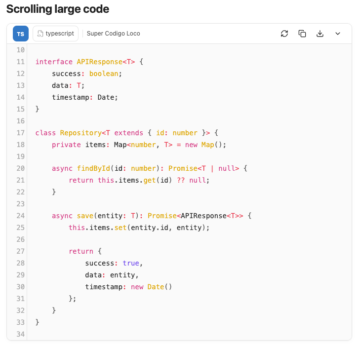
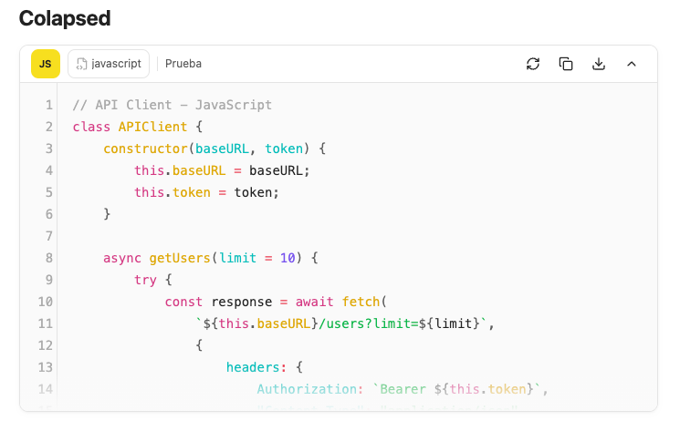
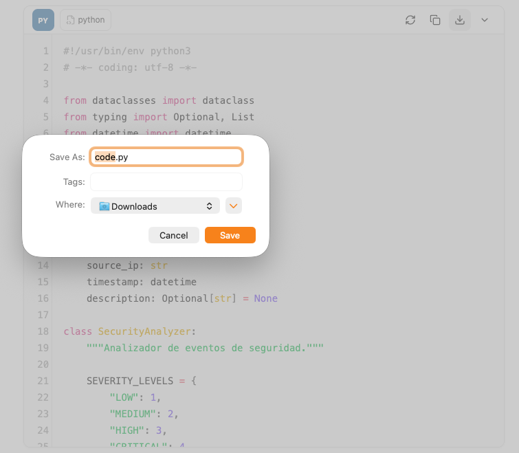
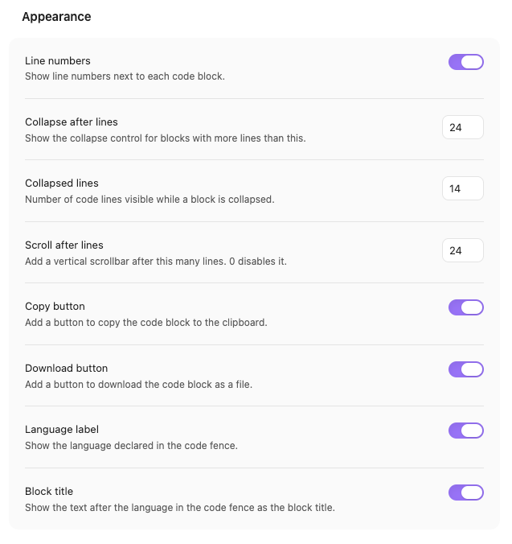

# Code Block Pro

**Make every fenced code block easier to read, copy, and share.**

Code Block Pro adds a compact, theme-aware header to code blocks in Obsidian.
Keep the language and optional block title visible, copy or download the exact
code in one click, and keep long blocks readable with line numbers, scrolling,
and collapse.

[Download the latest release](https://github.com/jalvarado-it/obsidian-code-block-pro/releases/latest) · [Installation](#installation) · [Settings](#settings)



## Why Code Block Pro?

- **Know what you're looking at.** Language badge, icon, and an optional title
  taken directly from the code fence.
- **Act without selecting code.** Copy or download the exact code, without line
  numbers or fences.
- **Keep long blocks under control.** Line numbers, vertical scrolling, and
  one-click collapse.
- **Stay in your workflow.** Works in Reading View and Live Preview.
- **Lightweight by design.** No runtime dependencies, with theme-aware styling.
- **Make it yours.** Every control can be disabled independently, with
  configurable thresholds.

## A closer look

### Collapse long blocks



The header stays available while the body collapses to a configurable number of
lines. Expand it again with the same control.

### Download the exact code



The fence language chooses the extension, such as `code.py`, `code.ts`, or
`code.js`. The downloaded file contains only the code: no title, line numbers,
or fences.

### Tune every detail



Configure line numbers, collapse and scroll thresholds, and which actions appear
in the header. Copy, download, language label, block title, and line numbers can
be disabled independently.

## Features

- Compact header with a language badge, icon, display name, and optional block
  title.
- Optional block title from the text after the language in the fence, for
  example ` ```javascript API client `.
- Copy icon with confirmation and screen reader feedback.
- Download button that saves the code block as `code.<language extension>`.
- Line numbers in Reading View and Live Preview, without changing the code or
  the copied text.
- Automatic line-number realignment when Obsidian reapplies a theme or CSS,
  plus a manual refresh control in Reading View.
- Collapsible long code blocks in Reading View, with configurable threshold and
  collapsed height.
- Optional vertical scrolling after a configurable number of lines in Reading
  View.
- Works in Reading View and Live Preview.
- Reading View supports fenced blocks inside callouts, blockquotes, and indented
  lists; Live Preview supports indented list fences.
- Theme-aware container, header, and controls built on Obsidian CSS variables.
- Copy, download, language label, block title, and line numbers can be disabled
  independently.
- Mermaid, Dataview, and DataviewJS blocks are left to their own processors.

Requires Obsidian 1.13.0 or later.

## Installation

### From the latest release

1. Download `main.js`, `manifest.json`, and `styles.css` from the
   [latest release](https://github.com/jalvarado-it/obsidian-code-block-pro/releases/latest).
2. Create `<vault>/.obsidian/plugins/code-block-pro/` if it does not exist.
3. Copy the three files into that folder.
4. Reload Obsidian and enable **Code Block Pro** in **Settings → Community
   plugins**.

### From source

1. Clone this repository into your vault's plugin folder:

   ```bash
   cd /path/to/vault/.obsidian/plugins
   git clone https://github.com/jalvarado-it/obsidian-code-block-pro.git code-block-pro
   cd code-block-pro
   ```

2. Install dependencies and build:

   ```bash
   npm install
   npm run build
   ```

3. Reload Obsidian and enable **Code Block Pro** in **Settings → Community
   plugins**.

### Manual file copy

Copy `main.js`, `manifest.json`, and `styles.css` into
`<vault>/.obsidian/plugins/code-block-pro/`, then enable the plugin.

## Development

```bash
npm install
npm run dev    # watch mode, rebuilds main.js on change
npm run build  # type-check and production bundle
npm run lint   # ESLint with eslint-plugin-obsidianmd
npm test       # Vitest unit tests
```

The build output is `main.js`, which is ignored by Git and attached to GitHub
releases instead.

### Testing

```bash
npm test
```

Unit tests cover fence parsing, nested prefixes, title matching, language
metadata, and settings normalization.

### Local testing

Install the built plugin into a vault with symlinks, so `npm run dev` rebuilds
are picked up without reinstalling:

```bash
npm run build
npm run install:vault
```

The installer asks for the vault path. You can also pass it directly or use an
environment variable:

```bash
npm run install:vault -- /path/to/vault
npm run install:vault -- /path/to/vault --copy
OBSIDIAN_VAULT=/path/to/vault npm run install:vault
```

Symlinks are the default. Use `--copy` for regular files instead (on Windows the
installer falls back to copying automatically if symlinks are unavailable).
After installing, reload Obsidian with `Cmd/Ctrl+R` or the **Reload app without
saving** command, then enable the plugin under **Settings → Community plugins**.

`npm run deploy` runs the build and then the installer.

## Project structure

```text
.
├── src/
│   ├── main.ts        # Plugin lifecycle, post-processor registration
│   ├── fence.ts       # Fence language and block title parsing
│   ├── language.ts    # Language names, icons, and ignored processors
│   ├── live-preview.ts # CodeMirror 6 extension for Live Preview
│   ├── processor.ts   # Reading view code block decoration
│   ├── toolbar.ts     # Shared header, actions, and collapse behavior
│   └── settings.ts    # Settings shape and settings tab
├── scripts/
│   └── install.mjs    # Local vault installer
├── screenshots/       # README screenshots
├── styles.css         # Scoped, theme-aware styles
├── manifest.json      # Plugin metadata
├── esbuild.config.mjs # Bundler configuration
├── version-bump.mjs   # Keeps versions.json in sync with npm version
└── versions.json      # Version to minimum app version map
```

## Settings

| Setting | Default | Description |
| --- | --- | --- |
| Line numbers | On | Show line numbers in a gutter. Numbered reading view blocks scroll horizontally instead of wrapping. |
| Collapse after lines | 24 | Show the collapse control for blocks with more lines than this. |
| Collapsed lines | 14 | Number of code lines visible while a block is collapsed. |
| Scroll after lines | 24 | Add a vertical scrollbar after this many lines. Defaults to the same value as Collapse after lines. 0 disables it. The effective height is at least Collapsed lines. |
| Copy button | On | Add a button to copy the code block to the clipboard. |
| Download button | On | Add a button to download the code block as a file (`code.<ext>`). |
| Language label | On | Show the language declared in the code fence. |
| Block title | On | Show the text after the language in the code fence as the block title. |

## Releasing

1. Bump the version with `npm version patch|minor|major`.
2. Push the commit and the signed tag.
3. The **Release** workflow builds the plugin, verifies the tag against
   `manifest.json`, generates `SHA256SUMS` and the release notes, attests the
   build, and creates the GitHub release with `main.js`, `manifest.json`,
   `styles.css`, the SBOMs, and the checksums.

Locally, `npm run checksums` and `npm run release-notes` generate the same
release metadata.

## Security

The plugin has no runtime npm dependencies. Obsidian and CodeMirror are
provided by the host application, and stored settings are validated against a
known boolean schema before use.

```bash
npm audit             # dependency vulnerabilities
npm run sbom          # CycloneDX / build and test dependencies
npm run sbom:spdx     # SPDX
npm run sbom:runtime  # runtime-only CycloneDX
```

The generated `sbom.cdx.json`, `sbom.spdx.json`, and `sbom.runtime.cdx.json`
files describe the dependency graph used to build and validate the plugin.

## License

MIT © 2026 Jesus Alvarado
